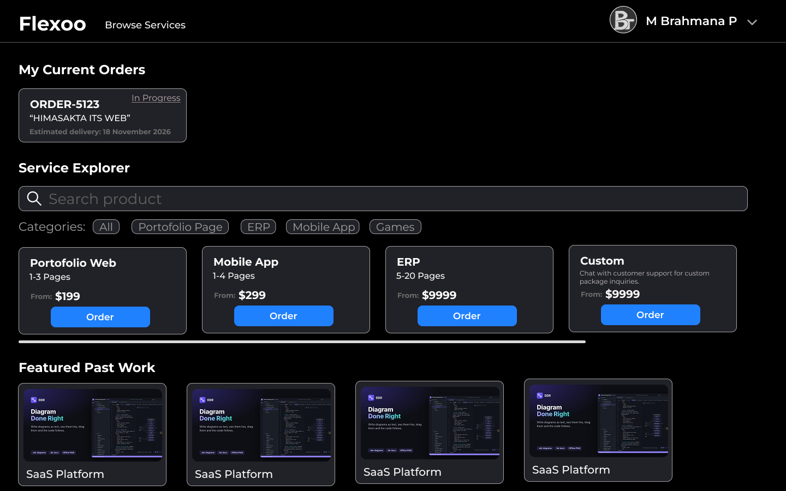
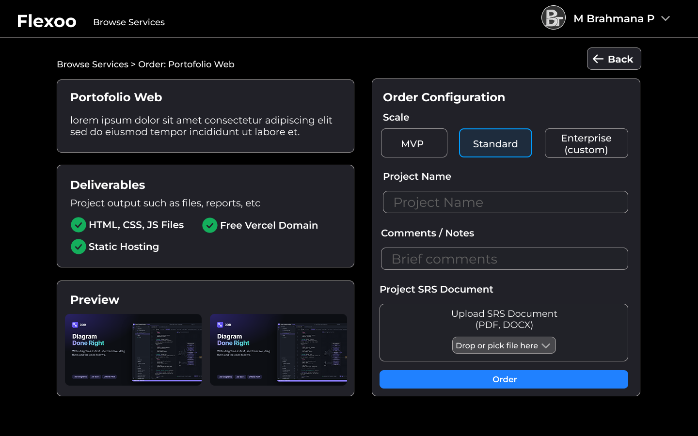
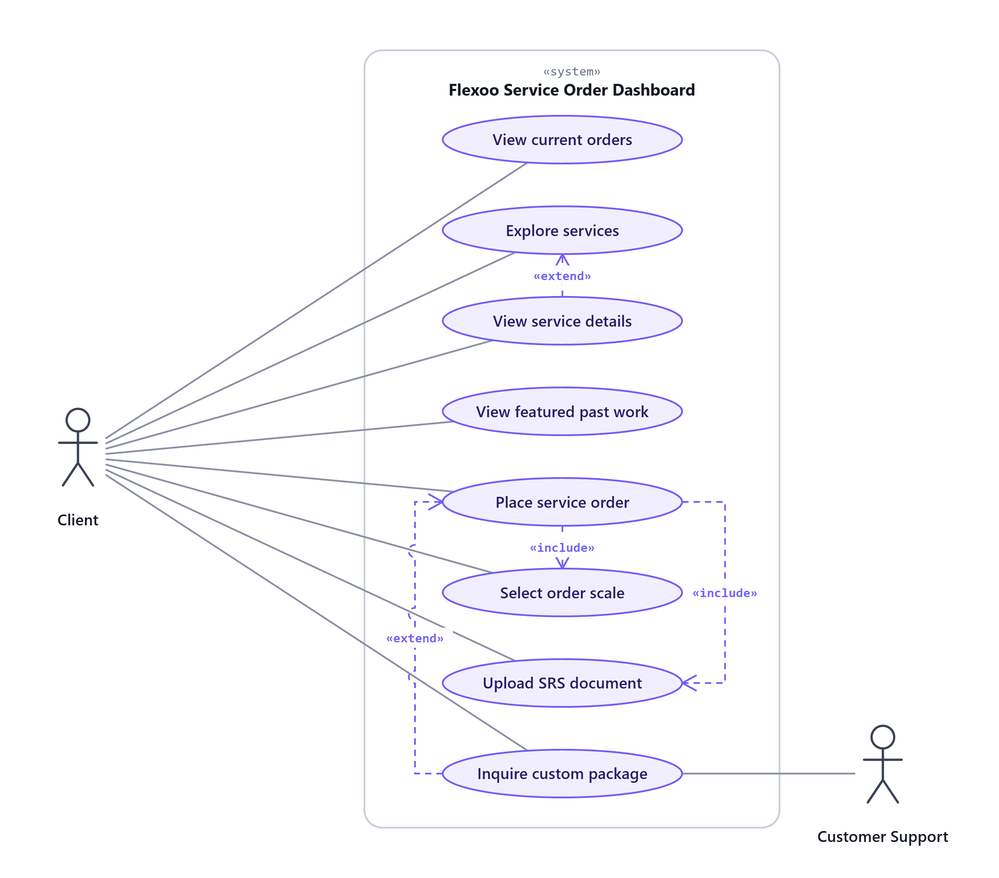
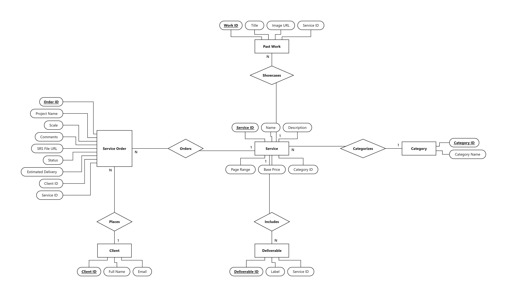
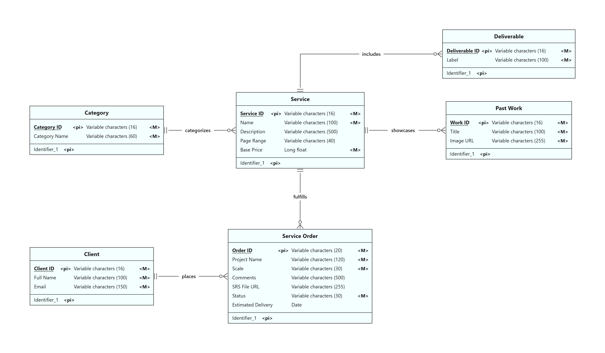
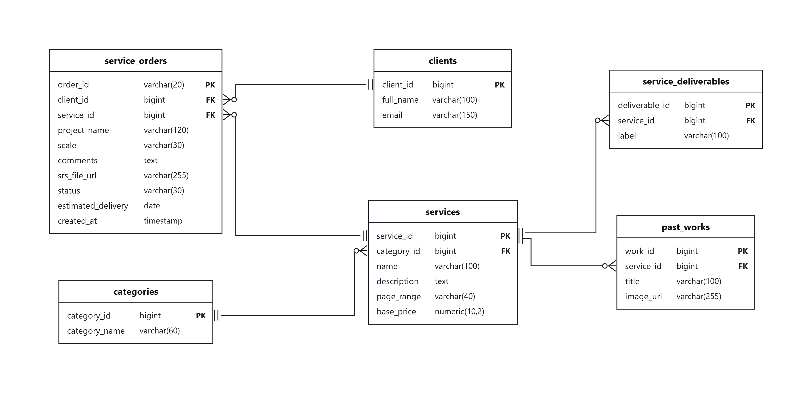

# Flexoo Service Order Pages  

Website demo ini terdiri dari 2 halaman utama:
- Explore Project Package  
- Configure Project & Order  

## Design Pages  
Berikut link figma: [project](https://www.figma.com/design/DzJRcz0XuW9AqNceoHEYO3/Flexoo-service-pages?node-id=1-219&t=DZF4LPuAtsSVHDU0-1)  
Live Website: [flexoo-service-order.vercel.app](https://flexoo-service-order.vercel.app/)  

### 1. Explore Package  
  

### 2. Configure & Order    
   

## Use Case  


### Dokumentasi Use Case Diagram (`Flexoo Service Order Dashboard`)

#### 1. Definisi Aktor (*Actors*)
| Aktor | Tipe Aktor | Deskripsi |
| :--- | :--- | :--- |
| **Client** | *Primary Actor* | Pengguna (klien) yang masuk ke dalam sistem **Flexoo Service Order Dashboard** untuk memantau pesanan berjalan, mencari layanan pembuatan perangkat lunak, melihat detail paket & portofolio, serta mengajukan pesanan proyek baru. |
| **Customer Support** | *Secondary Actor* | Pihak layanan pelanggan Flexoo yang menangani konsultasi dan diskusi kebutuhan khusus apabila klien memilih paket kustom (*Inquire custom package*). |

#### 2. Daftar Use Case & Relasi
| No | Nama Use Case | Aktor Terlibat | Relasi | Deskripsi Fungsional |
| :-: | :--- | :--- | :--- | :--- |
| 1 | **View current orders** | Client | Asosiasi langsung | Menampilkan daftar pesanan proyek yang telah disubmit oleh klien beserta informasi ID pesanan (`order_id`), nama proyek (`project_name`), status pengerjaan saat ini (`status`), serta estimasi waktu pengiriman (`estimated_delivery`). |
| 2 | **Explore services** | Client | Base use case dari *View service details* | Memungkinkan klien menjelajahi katalog paket layanan yang tersedia (*Portofolio Web*, *Mobile App*, *ERP*, *Custom*) menggunakan kolom pencarian produk maupun filter kategori (*All*, *Portofolio Page*, *ERP*, *Mobile App*, *Games*). |
| 3 | **View service details** | Client | `«extend»` ke **Explore services** | Perluasan dari proses eksplorasi layanan ketika klien memilih salah satu layanan untuk melihat rincian deskripsi paket, daftar *Deliverables* (mis. *HTML, CSS, JS Files*, *Free Vercel Domain*, *Static Hosting*), dan *Preview* proyek. |
| 4 | **View featured past work** | Client | Asosiasi langsung | Menampilkan galeri hasil proyek unggulan yang pernah diselesaikan (*Featured Past Work*) sebagai referensi portofolio bagi klien. |
| 5 | **Place service order** | Client | `«include»` **Select order scale** & **Upload SRS document** | Proses utama pengajuan pesanan proyek baru dengan mengisi nama proyek (*Project Name*), catatan tambahan (*Comments / Notes*), serta menyimpan pesanan ke database sehingga status proyek dapat dipantau pada bagian *My Current Orders*. |
| 6 | **Select order scale** | Client | `«include»` dari **Place service order** | Tahapan wajib dalam konfigurasi pemesanan di mana klien menentukan skala pengembangan proyek yang diinginkan: **MVP**, **Standard**, atau **Enterprise (custom)**. |
| 7 | **Upload SRS document** | Client | `«include»` dari **Place service order** | Tahapan dalam konfigurasi pemesanan untuk memilih file dokumen *Software Requirements Specification* (PDF/DOCX). Pada mode demo ini bersifat *no-operation* (tanpa penyimpanan file fisik ke storage, namun nama dokumen tetap tercatat pada kolom `srs_file_url`). |
| 8 | **Inquire custom package** | Client, Customer Support | `«extend»` ke **Place service order** | Alur opsional apabila klien memilih layanan **Custom** atau skala **Enterprise (custom)** yang membutuhkan komunikasi serta penyesuaian spesifikasi bersama **Customer Support**. |

## Database Modelling  
1. ERD  
  

2. CDM  
  

3. PDM  
  

## Arsitektur Proyek (MVC - Golang Gin)

```text
flexoo-service-order/
├── api/
│   └── index.go
├── src/
│   ├── config/
│   │   └── database.go
│   ├── controllers/
│   │   ├── auth_controller.go       # Autentikasi login & logout
│   │   ├── order_controller.go      # Pembuatan order, demo file upload no-op & update status
│   │   └── service_controller.go
│   ├── database/
│   │   └── schema.sql               # DDL & Seed SQL sesuai PDM
│   ├── middlewares/
│   │   └── auth_middleware.go       # cookie middleware
│   ├── models/
│   │   ├── category.go
│   │   ├── client.go
│   │   ├── deliverable.go
│   │   ├── past_work.go
│   │   ├── service.go
│   │   ├── service_order.go
│   │   └── store.go
│   ├── public/                      # Static assets (CSS, JS, Images)
│   ├── routes/
│   │   └── routes.go
│   ├── views/
│   │   ├── login.html
│   │   ├── explore.html
│   │   └── order.html
│   └── main.go
└── vercel.json
```

## Akun Demo & Cara Menjalankan

### Akun Login Demo
- **Username**: `brahmana` | **Password**: `password123`
- **Username**: `admin` | **Password**: `admin123`

### Menjalankan Secara Lokal
1. Salin `.env.example` menjadi `.env` dan isi `DATABASE_URL` dengan connection string **Neon DB** PostgreSQL Anda (opsional: jika dikosongkan, aplikasi otomatis berjalan menggunakan fallback store bawaan):
   ```bash
   cp .env.example .env
   ```
2. Jalankan server menggunakan Go:
   ```bash
   go run src/main.go
   ```
3. Buka `http://localhost:8080` pada browser.

### Deployment ke Vercel + Neon DB
1. Buat project database PostgreSQL di [Neon](https://neon.tech) dan salin `DATABASE_URL`.
2. Hubungkan repositori ini ke [Vercel](https://vercel.com) dan tambahkan Environment Variable:
   - `DATABASE_URL`: Connection string PostgreSQL dari Neon DB
   - `SESSION_SECRET`: Secret key untuk signing session cookie
3. Deploy ke Vercel. Tabel-tabel sesuai PDM (`categories`, `clients`, `services`, `service_deliverables`, `past_works`, `service_orders`) beserta data awal akan dibuat secara otomatis saat inisialisasi.

---
Fastering18  
Muhammad Brahmana Priambudi
